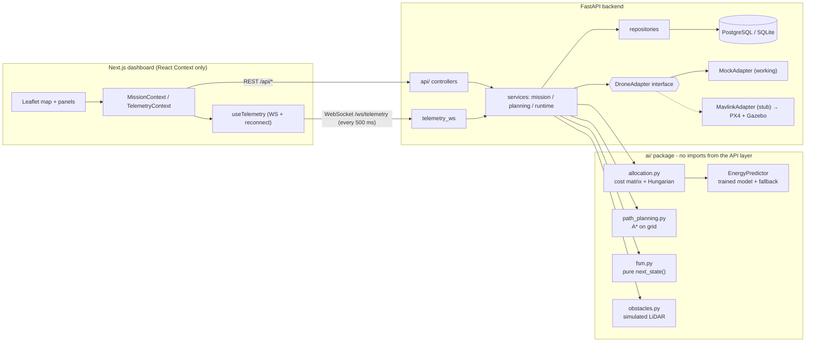
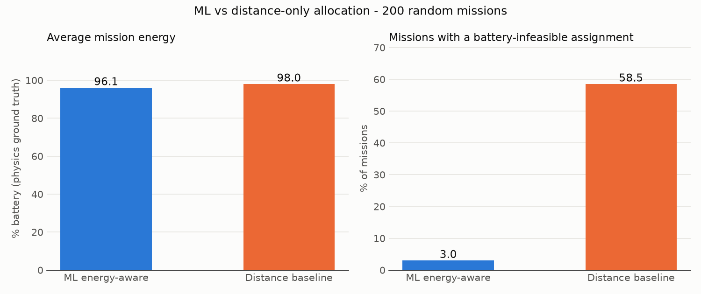

# AeroMind

**Simulation-based multi-drone mission command and coordination platform** - BTech capstone (AI & Data Science), 30 % review build.

A web dashboard where you register drones, click waypoints on a map, and press **Plan**. The backend runs **AI energy-aware task allocation** (a trained regression model feeding the Hungarian algorithm) and **A\* path planning**, then shows each drone's tasks and route in its own colour next to a **distance-only baseline** for comparison. Press **Start** and the drones fly live on the map (WebSocket telemetry from a mock simulator), each with its own **finite-state machine**. Inject an obstacle and a simulated **LiDAR** threshold triggers **A\* replanning**; a low battery triggers **return-to-launch**.

> **What is real and what is simulated:** everything in this repository runs for real *except the flight itself*. PX4 / Gazebo / MAVLink are **not** part of this milestone - the drones are driven by a `MockAdapter` behind the same `DroneAdapter` interface the real simulator will use. See [What is simulated vs real](#what-is-simulated-vs-real).

---

## Quick start

Requirements: Python 3.11, Node 20+, `make`. (Docker is optional.) On Windows use WSL.

```bash
make setup      # venv + Python deps + npm install
make seed       # 4 drones + a sample mission with 8 waypoints (SQLite, no Docker)
make dev        # API  http://localhost:8000  (docs at /docs)   Dashboard  http://localhost:3000
```

Or with Docker (PostgreSQL + backend + frontend):

```bash
docker compose up --build      # dashboard http://localhost:3000
```

Other commands:

| command | what it does |
|---|---|
| `make test` | all Python tests (AI + backend + end-to-end smoke) and the frontend type-check |
| `make train` | regenerate the dataset, retrain the energy model, re-execute the notebook |
| `make evaluate` | ML vs baseline over 200 random missions → `docs/allocation_comparison.png` |
| `make jupyter` | open `notebooks/01_energy_model.ipynb` (outputs are already stored) |
| `make checklist` | verify everything is demo-ready and print what is stubbed |
| `make reseed` | wipe the database and re-seed |

Configuration is by environment variable (see `.env.example`): `DATABASE_URL` (SQLite by default, PostgreSQL in Docker), `HOME_LAT/HOME_LON` (seed location), wind, battery reserve, and the simulation clock (`TICK_S`, `SPEEDUP`). The default speed-up (2×) makes the sample mission finish in about **1 min 45 s**.

Demo walkthrough: [`docs/DEMO_SCRIPT.md`](docs/DEMO_SCRIPT.md). Design decisions: [`docs/DECISIONS.md`](docs/DECISIONS.md).

---

## Architecture



**Deterministic-first.** The ML model is an *advisory cost estimator* inside the allocation module. `strategy=baseline` (straight-line distance, no model) always works, and `EnergyPredictor` falls back to a linear heuristic if the trained artifact is missing. Every AI module sits behind a Protocol in `ai/interfaces.py` (`EnergyEstimator`, `TaskAllocator`, `PathPlanner`) and `ai/` never imports from `backend/`.

**Layering.** `api/` (controllers) → `services/` → `repositories/` (SQL) and `ai/` (interfaces). The runtime talks to vehicles only through `DroneAdapter`.

### How a planning request flows

1. `POST /api/missions/{id}/plan?strategy=ml` loads the drones and tasks.
2. **Cost matrix** - ML: predicted % battery for every drone→task leg; a pair becomes `1e6` if *leg + return-to-home + 15 % reserve* exceeds the drone's battery. Baseline: metres.
3. **Hungarian** (`scipy.optimize.linear_sum_assignment`) per round; with more tasks than drones, drone positions and batteries are updated and another round runs until every task is assigned (or reported unassigned with a reason).
4. **A\*** routes home → task₁ → … → home around known obstacles; assignments are persisted and returned with the routes.

### Runtime loop (each 500 ms tick)

`adapter.step(dt)` → per drone: read telemetry → advance waypoint → simulated **LiDAR** (36 rays, 60 m) → **FSM** `next_state()` → entry action (arm, take off, follow leg, replan, return to launch, …) → broadcast JSON over the WebSocket.

FSM states: `IDLE → ARMED → TAKEOFF → EN_ROUTE ⇄ EXECUTING_TASK`, `EN_ROUTE → AVOIDING → EN_ROUTE` (LiDAR < 25 m → A\* replan), `→ RETURN_TO_LAUNCH → LANDED` (low battery, stop, or all tasks done), and `FAILSAFE` when no route exists.

---

## Requirement → file mapping

> The functional-requirement IDs below were **assigned while writing this README** from the project description. Reconcile them with the numbering in your SDD before the review (see `docs/DECISIONS.md` D-02).

| ID | Requirement | Main files |
|---|---|---|
| FR-01 | Register and monitor drones (type, battery, health, home, status) | `backend/app/models.py`, `api/drones.py`, `frontend/components/DroneList.tsx` |
| FR-02 | Create missions by placing waypoints on a map | `api/missions.py`, `services/mission_service.py`, `frontend/components/MapInner.tsx`, `MissionPanel.tsx` |
| FR-03 | AI energy-aware task allocation with deterministic fallback | `ai/allocation.py`, `ai/energy_model/*`, `services/planning_service.py`, `AllocationTab.tsx`, `ComparisonTab.tsx` |
| FR-04 | Obstacle-aware path planning and live replanning | `ai/path_planning.py`, `ai/obstacles.py`, `services/runtime_service.py` (`_replan`) |
| FR-05 | Real-time telemetry and mission monitoring | `api/telemetry_ws.py`, `services/runtime_service.py`, `frontend/hooks/useTelemetry.ts`, `EventsTab.tsx` |
| FR-06 | Safety behaviour: FSM, low-battery RTL, failsafe | `ai/fsm.py`, `services/runtime_service.py` |
| FR-07 | Simulator abstraction for the future PX4/Gazebo integration | `sim_adapter/base.py`, `mock_adapter.py`, `mavlink_adapter.py` |

---

## The AI parts

### Energy model (`ai/energy_model/`)

- **Dataset** - 20,000 synthetic flight legs (`generate_dataset.py`, seed 42). Target `energy_pct` follows a documented physical formula (base cost per metre by airframe, payload multiplier, climb penalty with a small descent credit, headwind/tailwind term, U-shaped speed-efficiency curve, ÷ battery health, 3 % noise). The formula is in the module docstring.
- **Training** (`train.py`) - one-hot `drone_type`, 80/20 split, 5-fold CV, three models compared, best chosen by lowest CV RMSE, saved with joblib plus `metrics.json`.
- **Results** (held-out test set):

  | model | MAE | RMSE | R² |
  |---|---|---|---|
  | LinearRegression | 2.79 | 4.11 | 0.893 |
  | RandomForest | 1.10 | 1.89 | 0.977 |
  | **GradientBoosting** (selected) | **0.64** | **1.04** | **0.993** |

- **Inference** (`predict.py`) - `EnergyPredictor.predict / predict_batch`; linear-heuristic fallback when the artifact is missing; linear extrapolation beyond the 3 km training range.
- **Notebook** - `notebooks/01_energy_model.ipynb`: problem, data, distributions, correlations, split, model comparison, predicted-vs-actual, residuals, feature importance, conclusion (executed, outputs stored).

### ML vs baseline

Both allocations are scored against the **noise-free physics formula**, not against the ML model that made them, so the comparison is not self-flattering. `make evaluate` (200 random missions, seed 7):

| | ML energy-aware | Distance baseline |
|---|---|---|
| average total mission energy | 96.1 % | 98.0 % |
| missions with ≥ 1 battery-infeasible assignment | **3.0 %** | **58.5 %** |

The honest reading: the **energy saving is modest on average (~2 %)**; the big win is **safety** - a distance-only allocator breaks the 15 % battery-reserve rule in most missions with mixed, partly-depleted drones, while the energy-aware one almost never does. The ML model's remaining 3 % come from prediction error right at the feasibility boundary. On the seeded sample mission the dashboard shows **67.5 % vs 77.2 %** total energy (12.6 % saving) and one unsafe assignment avoided.



---

## API summary

| method | path | purpose |
|---|---|---|
| GET / POST | `/api/drones` | list / register drones |
| GET / POST | `/api/missions`, GET `/api/missions/{id}` | list / create (with waypoints) / detail incl. routes |
| POST | `/api/missions/{id}/plan?strategy=ml\|baseline` | allocate + A\* route, persist assignments |
| GET | `/api/missions/{id}/compare` | ML vs baseline side by side |
| POST | `/api/missions/{id}/start` · `/stop` | start / stop the simulated run |
| POST / DELETE | `/api/missions/{id}/obstacles` | inject / clear obstacles |
| POST | `/api/drones/{id}/drain?pct=20` | demo control: battery fault on a flying drone |
| GET / POST | `/api/ai/model-info`, `/api/ai/predict-energy` | model metrics / single prediction |
| WS | `/ws/telemetry` | `snapshot` on connect, then a `tick` every 500 ms (drones, events, obstacles) |
| GET | `/health` | liveness + which estimator is serving |

Interactive docs: `http://localhost:8000/docs`.

## Repository layout

```
ai/                   energy_model/ (dataset, train, predict, artifacts), allocation, path_planning,
                      fsm, obstacles, interfaces, evaluate_allocation, tests/
backend/app/          api/, services/, repositories/, sim_adapter/, models, schemas, seed, main
backend/tests/        API, runtime (incl. end-to-end smoke), WebSocket tests
frontend/             Next.js (App Router) + TypeScript + Tailwind + react-leaflet + recharts
notebooks/            01_energy_model.ipynb (+ build_notebook.py that regenerates and executes it)
data/                 energy_dataset.csv
docs/                 DEMO_SCRIPT.md, DECISIONS.md, allocation_comparison.png
scripts/              final_checklist.py
```

## Tests

`make test` → **110 Python tests** (84 in `ai/tests`: allocation vs brute force, infeasible battery, more tasks than drones, A\* straight/around/no-path, every FSM transition, LiDAR; 26 in `backend/tests`: API, runtime scenarios, WebSocket) plus a TypeScript type-check. The end-to-end smoke test seeds, plans, starts the mock run and asserts the FSM transitions and that every drone lands with its reserve intact. Runtime scenarios also cover LiDAR-triggered replanning, battery-fault RTL, stop, and FAILSAFE on a blocked route.

## What is simulated vs real

| Area | Status |
|---|---|
| Task allocation (Hungarian + cost matrix), A\* planner, FSM, feasibility and reserve logic | **Real** - production-style code with tests |
| Energy model training, evaluation, serving | **Real pipeline on synthetic data.** The dataset is generated from a documented formula, so the accuracy shows the pipeline works, not real-world accuracy |
| Backend API, database, WebSocket, dashboard | **Real** |
| Drone flight | **Simulated.** `MockAdapter`: straight-line kinematics at cruise speed, fixed climb rate, battery drained with the same energy model + noise |
| LiDAR | **Simulated.** 36-ray circle-intersection scan against obstacles the user injects |
| Wind | One constant wind vector for the whole area (configurable) |
| **PX4 + Gazebo + MAVLink** | **Not implemented - next milestone.** `MavlinkAdapter` is a documented stub that raises `NotImplementedError`; it implements the same `DroneAdapter` interface, so the allocator, planner, FSM and runtime will not need to change |
| Out of scope | Authentication, multi-mission concurrency, hardware |

## Limitations

- OpenStreetMap tiles need internet access in the browser (the dashboard still works without tiles, only the background is blank).
- `docker-compose.yml` passes `docker compose config`, but the images were not built in the sandbox used to write this (no Docker daemon there); `make dev` was run and tested end to end instead.
- The A\* grid is 10 m; obstacles are circles; smoothing shortcuts segments but does not optimise altitude.
- Only one mission can run at a time; editing waypoints creates a new mission on the next **Plan**.
